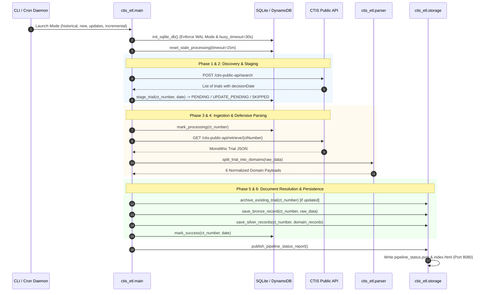
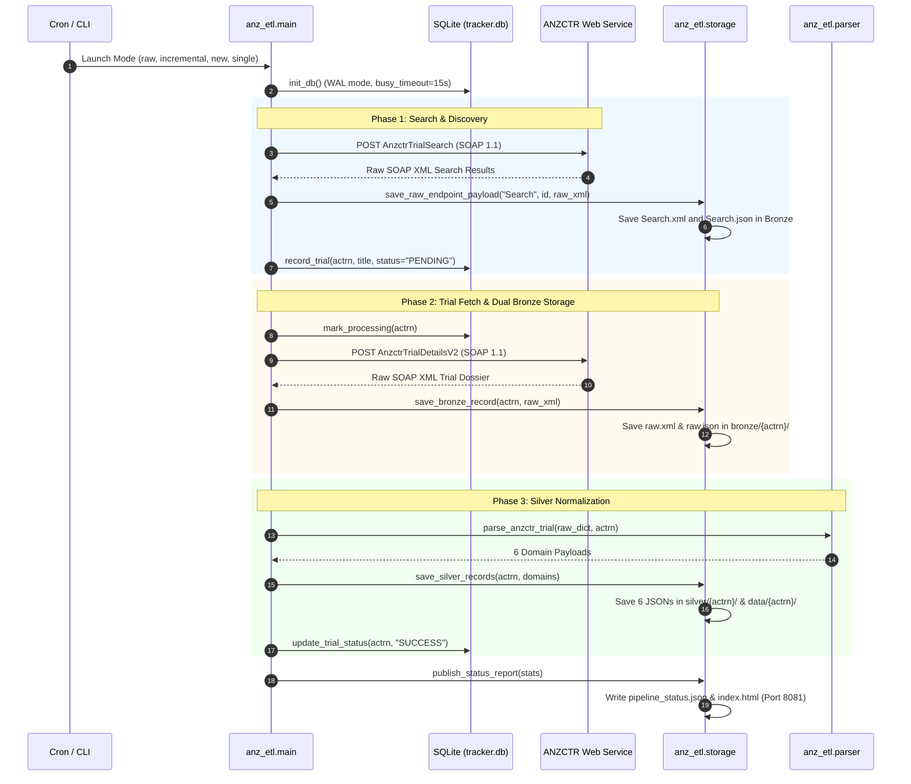

# Clinical Trial Multi-Container Platform (EU CTIS + ANZCTR)

[](https://www.python.org/downloads/)
[](#8-multi-container-docker-compose-deployment)
[](#9-persistent-host-storage--volume-mounts)
[](#6-eu-clinical-trials-ctis-pipeline-reference)
[](#10-web-dashboards--monitoring)
[](#10-web-dashboards--monitoring)

A unified, production-grade, multi-container ETL (Extract, Transform, Load) and analytics platform orchestrating global clinical trial ingestion pipelines for:

- **EU Clinical Trials (CTIS)**: European Medicines Agency (EMA) Clinical Trials Information System under Regulation (EU) No 536/2014.
- **ANZ Clinical Trials (ANZCTR)**: Australian New Zealand Clinical Trials Registry (NHMRC Clinical Trials Centre / WHO ICTRP Primary Registry).

Both services are containerized as independent, isolated microservices with automated cron scheduling, local and cloud storage backends (AWS S3 & DynamoDB / SQLite WAL), and embedded HTTP web monitoring dashboards, orchestrated seamlessly via **Docker Compose**.

---

## Table of Contents

- [1. Executive Platform Overview](#1-executive-platform-overview)
- [2. Registry Architecture Comparison Matrix](#2-registry-architecture-comparison-matrix)
- [3. System Architecture & Topology](#3-system-architecture--topology)
- [4. Master Directory & File Layout](#4-master-directory--file-layout)
- [5. Service Endpoints & Port Allocation](#5-service-endpoints--port-allocation)
- [6. EU Clinical Trials (CTIS) Pipeline Reference](#6-eu-clinical-trials-ctis-pipeline-reference)
  - [6.1 Regulatory Background & Scope](#61-regulatory-background--scope)
  - [6.2 Upstream REST API Specification](#62-upstream-rest-api-specification)
  - [6.3 End-to-End Execution Flow](#63-end-to-end-execution-flow)
  - [6.4 API Quirks & Technical Solutions](#64-api-quirks--technical-solutions)
  - [6.5 Storage Architecture (Bronze, Silver, History, Quarantine)](#65-storage-architecture-bronze-silver-history-quarantine)
  - [6.6 State Management & SQLite WAL](#66-state-management--sqlite-wal)
  - [6.7 Operational Modes & Commands](#67-operational-modes--commands)
- [7. ANZ Clinical Trials (ANZCTR) Pipeline Reference](#7-anz-clinical-trials-anzctr-pipeline-reference)
  - [7.1 Regulatory Background & Scope](#71-regulatory-background--scope)
  - [7.2 Upstream SOAP/ASMX Web Services (5 Core Operations)](#72-upstream-soapasmx-web-services-5-core-operations)
  - [7.3 SOAP Envelopes & XML-to-JSON Parsing Engine](#73-soap-envelopes--xml-to-json-parsing-engine)
  - [7.4 End-to-End Execution Flow](#74-end-to-end-execution-flow)
  - [7.5 Dual Bronze Architecture & Silver Normalization](#75-dual-bronze-architecture--silver-normalization)
  - [7.6 State Management & SQLite WAL](#76-state-management--sqlite-wal-1)
  - [7.7 Operational Modes & Raw API Testing](#77-operational-modes--raw-api-testing)
- [8. Multi-Container Docker Compose Deployment](#8-multi-container-docker-compose-deployment)
  - [8.1 Prerequisites](#81-prerequisites)
  - [8.2 Building Images](#82-building-images)
  - [8.3 Starting & Stopping Services](#83-starting--stopping-services)
  - [8.4 Live Log Streaming & Health Checks](#84-live-log-streaming--health-checks)
  - [8.5 Executing Commands Inside Containers](#85-executing-commands-inside-containers)
  - [8.6 Interactive Container Shell](#86-interactive-container-shell)
- [9. Persistent Host Storage & Volume Mounts](#9-persistent-host-storage--volume-mounts)
- [10. Web Dashboards & Monitoring](#10-web-dashboards--monitoring)
- [11. Unified Environment Configuration Reference](#11-unified-environment-configuration-reference)
- [12. Makefile Command Reference](#12-makefile-command-reference)
- [13. Troubleshooting & Operations Guide](#13-troubleshooting--operations-guide)

---

## 1. Executive Platform Overview

Modern clinical trial analytics requires aggregating trial registries across international jurisdictions. This platform provides a centralized, fault-tolerant ingestion engine capable of running continuously in enterprise environments:

1. **Cross-Continental Harmonization**: Ingests disparate European (EMA CTIS REST) and Australasian (ANZCTR SOAP ASMX XML) registries into a single unified directory layout.
2. **Standardized Silver Domain Schema**: Both pipelines deconstruct raw trial payloads into an identical **6-domain normalized JSON schema**:
   - `meta_data.json` (Registration identifiers, titles, dates, recruitment status)
   - `summary.json` (Brief summary, sponsor, health conditions, target sample size)
   - `full_trial_information.json` (Study design, phase, eligibility criteria, endpoints)
   - `trial_documents.json` (Protocols, regulatory approvals, permanent download endpoints)
   - `trial_results.json` (Outcome data, study results, publications)
   - `locations_and_contact_points.json` (Study sites, facilities, principal investigators)
3. **Resilient Dual-Tier Storage**:
   - **Bronze Tier**: Immutable audit layer storing exact untouched upstream data.
   - **Silver Tier**: Clean, standardized JSON domain models for analytics.
4. **Dual State Tracking (Zero-Lock)**:
   - **Local**: SQLite with Write-Ahead Logging (`PRAGMA journal_mode=WAL;`) and 15–30s busy timeouts to prevent lock contention between parallel crawler threads and dashboard web servers.
   - **Cloud**: Amazon DynamoDB (`EU_Clinical` and `ANZ_Clinical` tables) for distributed cloud persistence and cross-instance recovery.
5. **Independent Microservices via Docker Compose**:
   - Each registry pipeline runs in its own lightweight Debian container (`python:3.11-slim`), isolated by network namespaces but unified under `docker-compose.yml`.
   - Each container bundles an automated cron daemon, an embedded HTTP web server, and a stdout log streamer.

---

## 2. Registry Architecture Comparison Matrix

| Feature / Dimension | EU CTIS Pipeline (`eu_clinical_trial`) | ANZCTR Pipeline (`anz_clinical_trial`) |
| :--- | :--- | :--- |
| **Jurisdiction / Region** | European Union (27 member states + EEA) | Australia, New Zealand & Global |
| **Governing Authority** | European Medicines Agency (EMA) | NHMRC Clinical Trials Centre / WHO ICTRP |
| **Regulatory Mandate** | Regulation (EU) No 536/2014 (CTR) | WHO ICTRP Standards & ICMJE Requirements |
| **Upstream Protocol** | Modern Public REST API (HTTPS JSON) | SOAP 1.1 / 1.2 XML Web Services (ASMX) |
| **Service Endpoint** | `https://euclinicaltrials.eu/ctis-public-api` | `https://api.anzctr.org.au/WebServices/AnzctrWebservices.asmx` |
| **Target Operations / APIs** | `POST /search`, `GET /retrieve`, `GET /documents` | `AnzctrTrialSearch`, `ActSearchResults`, `AnzctrTrialDetails`, `AnzctrTrialDetailsV2`, `ActMoreInfo` |
| **Upstream Data Format** | JSON (Monolithic trial document) | SOAP XML (Structured XML elements) |
| **Bronze Tier Architecture** | Single `raw.json` payload | **Dual side-by-side** `raw.xml` + companion `raw.json` |
| **Silver Tier Architecture** | 6 Standardized Domain JSONs | 6 Standardized Domain JSONs |
| **Document Support** | PDF binary download + permanent public API URLs | Regulatory registry URL + protocol attachments |
| **History Archiving** | Timestamped snapshot before trial update | Snapshot support before trial update |
| **Local State Engine** | SQLite 3 WAL (`trials` table in `tracker.db`) | SQLite 3 WAL (`anz_trials` table in `tracker.db`) |
| **Cloud State Engine** | AWS DynamoDB (Table: `EU_Clinical`) | AWS DynamoDB (Table: `ANZ_Clinical`) |
| **Web Dashboard Port** | **`8080`** (`http://localhost:8080/`) | **`8081`** (`http://localhost:8081/`) |
| **Cron Sync Schedule** | Daily @ 02:00 AM UTC (New every 6h) | Daily @ 03:00 AM UTC (New every 6h, Report @ 04:00 AM) |
| **Package Directory** | [`eu_clinical_trial/ctis_etl/`](file:///d:/Workspace/Projects/Clinical%20Trial/eu_clinical_trial/ctis_etl/) | [`anz_clinical_trial/anz_etl/`](file:///d:/Workspace/Projects/Clinical%20Trial/anz_clinical_trial/anz_etl/) |
| **Detailed Documentation** | [`eu_clinical_trial/README.md`](file:///d:/Workspace/Projects/Clinical%20Trial/eu_clinical_trial/README.md) | [`anz_clinical_trial/README.md`](file:///d:/Workspace/Projects/Clinical%20Trial/anz_clinical_trial/README.md) |

---

## 3. System Architecture & Topology

```mermaid
graph TD
    subgraph Host["Host Machine (d:/Workspace/Projects/Clinical Trial)"]
        subgraph Net["Docker Network: clinical_trial_network"]
            EU["Container: eu_clinical_trial_pipeline<br/>Port 8080 (EU CTIS Dashboard & ETL)"]
            ANZ["Container: anz_clinical_trial_pipeline<br/>Port 8081 (ANZCTR Dashboard & ETL)"]
        end

        Compose["docker-compose.yml<br/>(Master Multi-Container Orchestrator)"] --> EU
        Compose --> ANZ

        subgraph StorageEU["eu_clinical_trial Host Volumes"]
            EUD["./eu_clinical_trial/data/<br/>(Bronze raw.json & 6 Silver JSONs)"]
            EUL["./eu_clinical_trial/logs/<br/>(cron.log, ctis_etl.log)"]
            EUT["./eu_clinical_trial/tracker.db<br/>(SQLite WAL Database)"]
        end

        subgraph StorageANZ["anz_clinical_trial Host Volumes"]
            ANZD["./anz_clinical_trial/data/<br/>(Dual Bronze XML+JSON & 6 Silver JSONs)"]
            ANZL["./anz_clinical_trial/logs/<br/>(cron.log, anz_etl.log)"]
            ANZT["./anz_clinical_trial/tracker.db<br/>(SQLite WAL Database)"]
        end

        EU --> EUD
        EU --> EUL
        EU --> EUT

        ANZ --> ANZD
        ANZ --> ANZL
        ANZ --> ANZT
    end

    EMA["EU CTIS Public REST API<br/>euclinicaltrials.eu"] -.->|HTTPS / JSON| EU
    ANZCTR["ANZCTR Web Services<br/>api.anzctr.org.au"] -.->|HTTPS SOAP 1.1 / XML| ANZ
    
    EU -.->|Optional Cloud Sync| S3_EU["AWS S3 (EU Buckets)"]
    EU -.->|Optional Cloud Sync| DDB_EU["AWS DynamoDB (EU_Clinical)"]
    ANZ -.->|Optional Cloud Sync| S3_ANZ["AWS S3 (ANZ Buckets)"]
    ANZ -.->|Optional Cloud Sync| DDB_ANZ["AWS DynamoDB (ANZ_Clinical)"]
```



---

## 4. Master Directory & File Layout

```text
Clinical Trial/
├── docker-compose.yml               # Master multi-container orchestration configuration
├── .env.example                     # Platform environment templates and port bindings
├── .gitignore                       # Global Git ignore rules (tracker.db, logs, data)
├── Makefile                         # High-level orchestration shortcuts (up, down, logs, status)
├── README.md                        # Master Platform Documentation (this document)
├── .vscode/                         # Editor configuration (repository isolation settings)
│
├── eu_clinical_trial/               # EU CTIS Pipeline & Microservice
│   ├── ctis_etl/                    # Core Python ETL package
│   │   ├── __init__.py              # Package initializer & version tag
│   │   ├── config.py                # Environment parser & directory bootstrap
│   │   ├── api_client.py            # EMA CTIS REST client (HTTP/2 pool, retry backoff)
│   │   ├── database.py              # SQLite WAL & AWS DynamoDB dual state engine
│   │   ├── parser.py                # Monolithic JSON to 6 Silver domain entities
│   │   ├── storage.py               # Bronze, Silver, History, Quarantine & S3 writer
│   │   └── main.py                  # CLI runner, multi-worker pool & mode dispatcher
│   ├── data/                        # Persistent trial storage
│   │   ├── bronze/{ctNumber}/       # Untouched raw.json from CTIS API
│   │   ├── silver/{ctNumber}/       # 6 normalized domain JSONs + documents/
│   │   ├── history/{ctNumber}/      # Timestamped historical versions of updated trials
│   │   ├── pipeline_status.json     # Live execution metrics feed
│   │   └── index.html               # Real-time web monitoring dashboard
│   ├── logs/                        # Application, cron, and dashboard web server logs
│   ├── quarantine/                  # Dead-letter queue for malformed payloads
│   ├── docs/                        # Architecture guides and API research notes
│   ├── crontab                      # Automated cron definitions (02:00 UTC sync, 6h discovery)
│   ├── Dockerfile                   # Production container definition (Python 3.11-slim)
│   ├── entrypoint.sh                # Container entrypoint (cron, webserver, bootstrap)
│   ├── requirements.txt             # Python dependencies (httpx, boto3, tabulate)
│   ├── tracker.db                   # SQLite state tracking database (WAL mode)
│   ├── download_trial_docs.py       # Standalone CLI utility for batch PDF downloading
│   ├── view_db.py                   # Standalone CLI utility for inspecting database state
│   └── README.md                    # Dedicated EU CTIS documentation (1,100+ lines)
│
└── anz_clinical_trial/              # ANZCTR Pipeline & Microservice
    ├── anz_etl/                     # Core Python ETL package
    │   ├── __init__.py              # Package initializer & version tag
    │   ├── config.py                # Environment parser & directory bootstrap
    │   ├── api_client.py            # ANZCTR SOAP ASMX client (envelope builder, retries)
    │   ├── database.py              # SQLite WAL & AWS DynamoDB dual state engine
    │   ├── parser.py                # XML to 6 Silver domain entities converter
    │   ├── storage.py               # Dual Bronze (XML+JSON), Silver & S3 writer
    │   └── main.py                  # CLI runner, multi-worker pool & mode dispatcher
    ├── data/                        # Persistent trial storage
    │   ├── bronze/{actrn}/          # DUAL STORAGE: raw.xml AND raw.json side-by-side
    │   ├── silver/{actrn}/          # 6 normalized domain JSONs
    │   ├── quarantine/              # Dead-letter queue for malformed payloads
    │   ├── pipeline_status.json     # Live execution metrics feed
    │   └── index.html               # Real-time web monitoring dashboard
    ├── logs/                        # Application, cron, and dashboard web server logs
    ├── docs/                        # Documentation and research specifications
    │   └── API Document.md          # Comprehensive ANZCTR Web Services specification
    ├── crontab                      # Automated cron definitions (03:00 UTC sync, 6h discovery)
    ├── Dockerfile                   # Production container definition (Python 3.11-slim)
    ├── entrypoint.sh                # Container entrypoint (cron, webserver, bootstrap)
    ├── requirements.txt             # Python dependencies (requests, xmltodict, boto3)
    ├── tracker.db                   # SQLite state tracking database (WAL mode)
    ├── test_raw_apis.py             # Standalone CLI tool to probe 5 raw SOAP operations
    └── README.md                    # Dedicated ANZCTR documentation (400+ lines)
```

---

## 5. Service Endpoints & Port Allocation

Both containers run embedded HTTP servers that expose live metrics, operational summaries, and health dashboards:

| Service | Container Name | Host Port | Internal Port | Web Dashboard / API | Status API Feed |
| :--- | :--- | :--- | :--- | :--- | :--- |
| **EU CTIS** | `eu_clinical_trial_pipeline` | `8080` | `8080` | [http://localhost:8080/](http://localhost:8080/) | [http://localhost:8080/pipeline_status.json](http://localhost:8080/pipeline_status.json) |
| **ANZCTR** | `anz_clinical_trial_pipeline` | `8081` | `8081` | [http://localhost:8081/](http://localhost:8081/) | [http://localhost:8081/pipeline_status.json](http://localhost:8081/pipeline_status.json) |

---

## 6. EU Clinical Trials (CTIS) Pipeline Reference

### 6.1 Regulatory Background & Scope

Under the **European Union Clinical Trials Regulation (Regulation (EU) No 536/2014 - CTR)**, effective January 31, 2022, all clinical trials in the EU and EEA are submitted and overseen via the **Clinical Trials Information System (CTIS)** managed by the **European Medicines Agency (EMA)**. CTIS provides a unified public portal (`https://euclinicaltrials.eu/ctis-public-api`) exposing trial metadata, scientific dossiers, sponsor information, study sites, and authorized regulatory documents.

> [!NOTE]
> CTIS covers trials authorized under CTR from January 31, 2022 onward (~12,500+ trials). Legacy trials registered under the older Clinical Trials Directive (EC 2001/20) reside in EudraCT and are not exposed by the CTIS public REST API.

### 6.2 Upstream REST API Specification

The CTIS API is a RESTful JSON service with three primary endpoints:

1. **`POST /ctis-public-api/search`**:
   - Queries trial listings with pagination and sorting.
   - **Request Body Envelope**:
     ```json
     {
       "pagination": {"page": 1, "size": 100},
       "sort": {"property": "decisionDate", "direction": "DESC"},
       "searchCriteria": {}
     }
     ```

   - **Pagination Notes**: 1-indexed. Maximum page size is 100.
2. **`GET /ctis-public-api/retrieve/{ctNumber}`**:
   - Retrieves the full, unredacted trial dossier by EU Clinical Trial Number (e.g. `2023-504423-38-00`).
   - Returns a monolithic JSON payload containing study parts, sponsor details, member states concerned (MSC), and document arrays.
3. **`GET /ctis-public-api/documents/{ctNumber}/{uuid}/download`**:
   - Permanent public download endpoint that dynamically generates a fresh pre-signed S3 download URL for trial protocol PDFs and study documents.

### 6.3 End-to-End Execution Flow

The EU CTIS pipeline follows an 8-phase execution cycle:



### 6.4 API Quirks & Technical Solutions

1. **The 10,000 Record Pagination Cap & Bi-Directional Dual-Pass Solution**:
   - **Problem**: The CTIS search endpoint is backed by an OpenSearch cluster with `index.max_result_window = 10000`. Querying page 101+ returns `data: []`, leaving ~2,500 historical trials unreachable via simple pagination.
   - **Solution**: The pipeline implements a **Bi-Directional Dual-Pass Algorithm**:
     - *Pass 1 (`DESC`)*: Discovers ~10,000 newest trials from Present back to ~March 2024.
     - *Pass 2 (`ASC`)*: Discovers ~10,000 oldest trials from January 2022 forward to ~August 2025.
     - Overlapping records in the middle zone are deduplicated via SQLite state checks, achieving **100% catalog coverage (~12,572+ trials)**.
2. **S3 Pre-Signed URL 300-Second Expiration**:
   - **Problem**: Document links in raw API responses expire in 5 minutes (`X-Amz-Expires=300`).
   - **Solution**: The pipeline rewrites document URLs in `trial_documents.json` to the permanent public endpoint (`https://euclinicaltrials.eu/ctis-public-api/documents/{ctNumber}/{uuid}/download`) and optionally downloads binary PDFs locally when `DOWNLOAD_DOCUMENTS=true`.
3. **Empty 200 OK Responses on Missing Records**:
   - Missing or redacted trials return `HTTP 200 OK` with `{}` instead of `404 Not Found`. `api_client.py` validates that `ctNumber` exists and routes empty payloads to `./quarantine/`.
4. **5 Defensive Firewall Layers**:
   - HTTP/2 persistent connection pooling, 100ms per-worker request delays, randomized jittered exponential backoff for HTTP 429/503, and automated worker pool auto-throttling.

### 6.5 Storage Architecture (Bronze, Silver, History, Quarantine)

```text
eu_clinical_trial/data/
├── bronze/
│   └── 2023-504423-38-00/
│       └── raw.json                         # Exact untouched response from /retrieve/{ctNumber}
├── silver/
│   └── 2023-504423-38-00/
│       ├── meta_data.json                   # Trial identity, titles, status, dates
│       ├── summary.json                     # Plain-language summary, sponsor, conditions
│       ├── full_trial_information.json      # Study design, endpoints, authorizedPartI
│       ├── trial_documents.json             # Protocol metadata & permanent download URLs
│       ├── trial_results.json               # Clinical study report & outcome summaries
│       ├── locations_and_contact_points.json # Clinical sites & principal investigators
│       └── documents/                       # Optional downloaded binary PDFs
├── history/
│   └── 2023-504423-38-00/
│       └── 20261105T120000Z/                # Prior version snapshot preserved before update
├── quarantine/                              # Dead-letter queue for failed/unparseable records
├── pipeline_status.json                     # Real-time metrics JSON feed
└── index.html                               # Auto-refreshing web dashboard (Port 8080)
```

### 6.6 State Management & SQLite WAL

- **Database**: `eu_clinical_trial/tracker.db`
- **Concurrency Mode**: Enforces `PRAGMA journal_mode=WAL;` and `PRAGMA busy_timeout=30000;`.
- **Primary Table (`trials`)**:
  ```sql
  CREATE TABLE IF NOT EXISTS trials (
      ct_number TEXT PRIMARY KEY,
      title TEXT,
      last_publish_date TEXT,
      sync_status TEXT NOT NULL DEFAULT 'PENDING',
      attempts INTEGER DEFAULT 0,
      last_checked TEXT,
      error_message TEXT,
      created_at TEXT NOT NULL,
      updated_at TEXT NOT NULL
  );
  ```

- **Cloud Backend**: Synchronizes with Amazon DynamoDB table `EU_Clinical` (`pk: euc#{ctNumber}`).

### 6.7 Operational Modes & Commands

```bash
# Pre-flight environment and connectivity check
python -m ctis_etl.main --mode check

# Print sync statistics and update web dashboard
python -m ctis_etl.main --mode status

# Incremental sync (lookback 7 days)
python -m ctis_etl.main --mode incremental --lookback-days 7

# Ingest new trials published in the last 7 days
python -m ctis_etl.main --mode new --lookback-days 7

# Detect and sync amendments for previously ingested trials
python -m ctis_etl.main --mode updates --lookback-days 7

# Full historical backfill (5 concurrent workers)
python -m ctis_etl.main --mode historical --workers 5

# Fetch a single trial by number
python -m ctis_etl.main --mode single --ct-number 2023-504423-38-00

# Retry failed or quarantined trials
python -m ctis_etl.main --mode retry-failed
```

---

## 7. ANZ Clinical Trials (ANZCTR) Pipeline Reference

### 7.1 Regulatory Background & Scope

The **Australian New Zealand Clinical Trials Registry (ANZCTR)** is an online register of clinical trials being undertaken in Australia, New Zealand, and internationally. Managed by the NHMRC Clinical Trials Centre at the University of Sydney, ANZCTR is recognized as an official **Primary Registry in the World Health Organization (WHO) International Clinical Trials Registry Platform (ICTRP)** and satisfies the clinical trial registration requirements of the International Committee of Medical Journal Editors (ICMJE).

### 7.2 Upstream SOAP/ASMX Web Services (5 Core Operations)

The ANZCTR upstream service is an ASP.NET ASMX SOAP Web Service located at:

- **Endpoint**: `https://api.anzctr.org.au/WebServices/AnzctrWebservices.asmx`
- **WSDL Definition**: `https://api.anzctr.org.au/WebServices/AnzctrWebservices.asmx?WSDL`
- **XML Target Namespace**: `http://anzctr.org.au/WebServices/AnzctrWebServices`

The pipeline targets 5 core operations:

| # | Operation | ASMX Method | SOAPAction Header | Purpose & Usage |
| :---: | :--- | :--- | :--- | :--- |
| **1** | **`Search`** | `AnzctrTrialSearch` | `"http://anzctr.org.au/WebServices/AnzctrWebServices/AnzctrTrialSearch"` | Comprehensive search query across the registry by keyword or conditions. |
| **2** | **`result`** | `ActSearchResults` | `"http://anzctr.org.au/WebServices/AnzctrWebServices/ActSearchResults"` | Specialized query returning trial search result sets. |
| **3** | **`detail`** | `AnzctrTrialDetails` | `"http://anzctr.org.au/WebServices/AnzctrWebServices/AnzctrTrialDetails"` | Retrieves detailed base trial record by ACTRN identifier or database ID. |
| **4** | **`detailv2`** | `AnzctrTrialDetailsV2` | `"http://anzctr.org.au/WebServices/AnzctrWebServices/AnzctrTrialDetailsV2"` | Comprehensive Schema V2 trial dossier by ACTRN identifier. |
| **5** | **`detailresult`** | `ActMoreInfo` | `"http://anzctr.org.au/WebServices/AnzctrWebServices/ActMoreInfo"` | Supplementary trial outcomes, results, and study publications (`trialId`, `ds: 1`). |

### 7.3 SOAP Envelopes & XML-to-JSON Parsing Engine

Every request is dispatched via HTTP `POST` with `Content-Type: text/xml; charset=utf-8` and a corresponding `SOAPAction` header.

Sample SOAP envelope for `AnzctrTrialDetailsV2`:
```xml
<?xml version="1.0" encoding="utf-8"?>
<soap:Envelope xmlns:xsi="http://www.w3.org/2001/XMLSchema-instance" 
               xmlns:xsd="http://www.w3.org/2001/XMLSchema" 
               xmlns:soap="http://schemas.xmlsoap.org/soap/envelope/">
  <soap:Body>
    <AnzctrTrialDetailsV2 xmlns="http://anzctr.org.au/WebServices/AnzctrWebServices">
      <ids>ACTRN12613000001741</ids>
      <version>1</version>
    </AnzctrTrialDetailsV2>
  </soap:Body>
</soap:Envelope>
```

#### Dual Bronze XML + JSON Ingestion

Because the ANZCTR server communicates natively in XML (it lacks ASP.NET `[ScriptService]` attributes for direct JSON POST), the pipeline uses `xmltodict` (with fallback to `xml.etree.ElementTree`) to parse the SOAP envelope into a companion JSON document.

Every trial ingested stores **both files side-by-side** in Bronze:

- `raw.xml`: The exact, byte-for-byte SOAP response for regulatory auditing and replay.
- `raw.json`: The converted JSON object hierarchy for rapid downstream querying and indexing.

### 7.4 End-to-End Execution Flow



### 7.5 Dual Bronze Architecture & Silver Normalization

```text
anz_clinical_trial/data/
├── bronze/
│   └── ACTRN12613000001741/
│       ├── raw.xml                         # Exact raw SOAP XML response
│       ├── raw.json                        # Parsed JSON companion
│       ├── Search.xml & Search.json        # Operation 1 capture
│       ├── result.xml & result.json        # Operation 2 capture
│       ├── detail.xml & detail.json        # Operation 3 capture
│       ├── detailv2.xml & detailv2.json    # Operation 4 capture
│       └── detailresult.xml & .json        # Operation 5 capture
├── silver/
│   └── ACTRN12613000001741/
│       ├── meta_data.json                  # ACTRN, titles, registration dates, status
│       ├── summary.json                    # Brief summary, sponsor, health conditions
│       ├── full_trial_information.json     # Study design, phase, eligibility criteria
│       ├── trial_documents.json            # Registry review URL, protocol references
│       ├── trial_results.json              # Study results, outcomes, publications
│       └── locations_and_contact_points.json # Study sites, countries, contacts
├── quarantine/                             # Dead-letter queue for failed/unparseable records
├── pipeline_status.json                    # Real-time metrics JSON feed
└── index.html                              # Auto-refreshing web dashboard (Port 8081)
```

### 7.6 State Management & SQLite WAL

- **Database**: `anz_clinical_trial/tracker.db`
- **Concurrency Mode**: Enforces `PRAGMA journal_mode=WAL;` and `PRAGMA busy_timeout=15000;`.
- **Primary Table (`anz_trials`)**:
  ```sql
  CREATE TABLE IF NOT EXISTS anz_trials (
      actrn TEXT PRIMARY KEY,
      title TEXT,
      registration_date TEXT,
      last_updated_date TEXT,
      sync_status TEXT NOT NULL DEFAULT 'PENDING',
      attempts INTEGER DEFAULT 0,
      last_checked TEXT,
      error_message TEXT,
      created_at TEXT NOT NULL,
      updated_at TEXT NOT NULL
  );
  CREATE INDEX IF NOT EXISTS idx_anz_sync_status ON anz_trials(sync_status);
  CREATE INDEX IF NOT EXISTS idx_anz_updated_date ON anz_trials(last_updated_date);
  ```

- **Cloud Backend**: Synchronizes with Amazon DynamoDB table `ANZ_Clinical` (`pk: anzctr#{actrn}`).

### 7.7 Operational Modes & Raw API Testing

```bash
# Query initial 5 operations and capture raw XML + JSON companion
python -m anz_etl.main --mode raw --actrn ACTRN12613000001741

# Run standalone raw API test script across all 5 endpoints
python test_raw_apis.py ACTRN12613000001741 oncology

# Pre-flight environment and web service check
python -m anz_etl.main --mode check

# Print sync statistics and render web dashboard
python -m anz_etl.main --mode status

# Incremental sync (lookback 7 days)
python -m anz_etl.main --mode incremental --lookback-days 7

# Ingest a single trial by ACTRN
python -m anz_etl.main --mode single --actrn ACTRN12613000001741

# Retry failed trials
python -m anz_etl.main --mode retry-failed
```

---

## 8. Multi-Container Docker Compose Deployment

### 8.1 Prerequisites

1. **Docker Engine**: Version 20.10+ or Docker Desktop on Windows / macOS / Linux.
2. **Docker Compose**: Compose v2 (`docker compose`) or Compose v1 (`docker-compose`).
3. **Host Ports**: Ensure host ports `8080` (EU CTIS) and `8081` (ANZCTR) are available.

### 8.2 Building Images

Build both container images defined in `docker-compose.yml`:

```bash
# Build both images concurrently
docker-compose build

# Rebuild from scratch without using cached layers
docker-compose build --no-cache

# Build a single service only
docker-compose build eu_clinical_trial
docker-compose build anz_clinical_trial
```

### 8.3 Starting & Stopping Services

```bash
# Launch both containers in detached (background) mode
docker-compose up -d

# Launch with build verification
docker-compose up -d --build

# Launch in foreground (useful for observing initial boot)
docker-compose up

# Stop containers gracefully (preserves state)
docker-compose stop

# Resume stopped containers
docker-compose start

# Restart containers
docker-compose restart

# Stop and remove containers and virtual network
docker-compose down

# Complete teardown including orphan containers
docker-compose down --remove-orphans
```

### 8.4 Live Log Streaming & Health Checks

```bash
# Stream combined logs from both services
docker-compose logs -f

# Stream logs with timestamps
docker-compose logs -f -t

# Stream EU CTIS pipeline logs only
docker-compose logs --tail=100 -f eu_clinical_trial

# Stream ANZCTR pipeline logs only
docker-compose logs --tail=100 -f anz_clinical_trial

# Check running container statuses and mapped ports
docker-compose ps

# Monitor live CPU and memory utilization
docker stats eu_clinical_trial_pipeline anz_clinical_trial_pipeline
```

### 8.5 Executing Commands Inside Containers

You can invoke any pipeline operational mode inside active containers using `docker-compose exec`:

#### EU CTIS Commands
```bash
# Check connectivity and health
docker-compose exec eu_clinical_trial python -m ctis_etl.main --mode check

# Display pipeline statistics
docker-compose exec eu_clinical_trial python -m ctis_etl.main --mode status

# Run incremental sync (lookback 7 days)
docker-compose exec eu_clinical_trial python -m ctis_etl.main --mode incremental --lookback-days 7

# Run full historical backfill with 5 workers
docker-compose exec eu_clinical_trial python -m ctis_etl.main --mode historical --workers 5

# Fetch a single trial by number
docker-compose exec eu_clinical_trial python -m ctis_etl.main --mode single --ct-number 2023-504423-38-00
```

#### ANZCTR Commands
```bash
# Check connectivity and health
docker-compose exec anz_clinical_trial python -m anz_etl.main --mode check

# Display pipeline statistics
docker-compose exec anz_clinical_trial python -m anz_etl.main --mode status

# Ingest single trial (dual XML + JSON Bronze + 6 Silver JSONs)
docker-compose exec anz_clinical_trial python -m anz_etl.main --mode single --actrn ACTRN12613000001741

# Run 5-operation raw XML probe
docker-compose exec anz_clinical_trial python test_raw_apis.py ACTRN12613000001741 oncology

# Retry failed trials
docker-compose exec anz_clinical_trial python -m anz_etl.main --mode retry-failed
```

### 8.6 Interactive Container Shell

Attach an interactive Bash shell to any container for debugging or filesystem inspection:

```bash
# Shell into EU CTIS container
docker-compose exec eu_clinical_trial /bin/bash

# Shell into ANZCTR container
docker-compose exec anz_clinical_trial /bin/bash
```

Inside the container shell:
```bash
# Inspect environment variables
env | sort

# Inspect active cron schedule
crontab -l

# Inspect cron execution log
cat /app/logs/cron.log

# Inspect web dashboard server log
tail -n 50 /app/logs/webserver.log
```

---

## 9. Persistent Host Storage & Volume Mounts

All ingested trial data, SQLite state databases, and execution logs are persisted on the host filesystem via Docker bind mounts. Stopping, removing, or rebuilding containers will **never delete or overwrite your data**.

```text
Host Filesystem                                  Container Path
─────────────────────────────────────────────────────────────────────────────
./eu_clinical_trial/data/          ──bind──>    /app/data/
./eu_clinical_trial/logs/          ──bind──>    /app/logs/
./eu_clinical_trial/quarantine/    ──bind──>    /app/quarantine/
./eu_clinical_trial/tracker.db     ──bind──>    /app/tracker.db

./anz_clinical_trial/data/         ──bind──>    /app/data/
./anz_clinical_trial/logs/         ──bind──>    /app/logs/
./anz_clinical_trial/quarantine/   ──bind──>    /app/quarantine/
./anz_clinical_trial/tracker.db    ──bind──>    /app/tracker.db
```

---

## 10. Web Dashboards & Monitoring

Each service runs an embedded HTTP daemon serving an auto-refreshing dashboard and a standardized JSON status feed:

- **EU CTIS Dashboard**: [http://localhost:8080/](http://localhost:8080/)
  - Renders total tracked trials, success/pending/failed breakdown, daily ingestion activity charts, and recent run history.
- **ANZCTR Dashboard**: [http://localhost:8081/](http://localhost:8081/)
  - Renders total tracked trials, success/pending/failed breakdown, dual Bronze storage counters, and cron sync status.
- **Machine-Readable Metrics**:
  - `http://localhost:8080/pipeline_status.json` (EU CTIS)
  - `http://localhost:8081/pipeline_status.json` (ANZCTR)

---

## 11. Unified Environment Configuration Reference

### Root Environment Overrides (`.env` or system environment)

| Variable | Default | Description |
| :--- | :--- | :--- |
| `EU_PORT` | `8080` | Host port mapped to the EU CTIS web dashboard |
| `ANZ_PORT` | `8081` | Host port mapped to the ANZCTR web dashboard |
| `EU_STARTUP_MODE` | `status` | Mode run on EU container startup (`status`, `report`, `incremental`) |
| `ANZ_STARTUP_MODE` | `status` | Mode run on ANZ container startup (`status`, `report`, `incremental`) |
| `EU_RUN_ON_STARTUP` | `true` | Whether EU container runs the startup task upon boot |
| `ANZ_RUN_ON_STARTUP` | `true` | Whether ANZ container runs the startup task upon boot |
| `EU_CRON_SCHEDULE` | `0 2 * * *` | Cron schedule for EU CTIS daily incremental sync (02:00 UTC) |
| `ANZ_CRON_SCHEDULE` | `0 3 * * *` | Cron schedule for ANZCTR daily incremental sync (03:00 UTC) |

### EU CTIS Service Configuration (`eu_clinical_trial/.env`)

| Variable | Default | Description |
| :--- | :--- | :--- |
| `PORT` | `8080` | Internal web server port |
| `STORAGE_BACKEND` | `local` | Storage target: `local`, `s3`, or `both` |
| `STATE_BACKEND` | `sqlite` | State database: `sqlite`, `dynamodb`, or `both` |
| `MAX_WORKERS` | `5` | Concurrent extraction workers (recommended: 3–5) |
| `REQUEST_DELAY_SECONDS`| `0.1` | Pacing delay between requests per worker |
| `LOOKBACK_DAYS` | `7` | Default lookback window for incremental sync |
| `DOWNLOAD_DOCUMENTS` | `false` | Whether to download binary PDFs locally |
| `AWS_REGION` | `us-east-1` | AWS region for S3 and DynamoDB |
| `S3_BUCKET_NAME` | `""` | AWS S3 bucket name |
| `DYNAMODB_TABLE_NAME` | `EU_Clinical` | DynamoDB state tracking table |

### ANZCTR Service Configuration (`anz_clinical_trial/.env`)

| Variable | Default | Description |
| :--- | :--- | :--- |
| `PORT` | `8081` | Internal web server port |
| `STORAGE_BACKEND` | `local` | Storage target: `local`, `s3`, or `both` |
| `STATE_BACKEND` | `sqlite` | State database: `sqlite`, `dynamodb`, or `both` |
| `MAX_WORKERS` | `4` | Concurrent extraction workers |
| `LOOKBACK_DAYS` | `7` | Default lookback window for incremental sync |
| `AWS_REGION` | `us-east-1` | AWS region for S3 and DynamoDB |
| `S3_BUCKET_NAME` | `""` | AWS S3 bucket name |
| `DYNAMODB_TABLE_NAME` | `ANZ_Clinical` | DynamoDB state tracking table |

---

## 12. Makefile Command Reference

If `make` is installed on your host system, use these convenient shortcuts:

| Command | Action |
| :--- | :--- |
| `make build` | Build all container images via `docker-compose build` |
| `make up` | Start all containers in detached mode (`docker-compose up -d`) |
| `make down` | Stop and remove all containers and network (`docker-compose down`) |
| `make restart` | Restart both services (`docker-compose restart`) |
| `make ps` | Show container statuses and mapped ports |
| `make logs` | Stream combined logs from all containers |
| `make logs-eu` | Stream logs from EU CTIS container |
| `make logs-anz` | Stream logs from ANZCTR container |
| `make status` | Query live status reports from both running services |

---

## 13. Troubleshooting & Operations Guide

### Port 8080 or 8081 Already Allocated

- **Symptom**: `Bind for 0.0.0.0:8080 failed: port is already allocated`.
- **Solution**: Set custom host ports in your root `.env` file or launch with overrides:
  ```bash
  EU_PORT=8090 ANZ_PORT=8091 docker-compose up -d
  ```

### Windows Shell Script Line Endings (CRLF vs LF)

- **Symptom**: `/app/entrypoint.sh: line 2: $'\r': command not found`.
- **Cause**: Git on Windows may convert LF line endings to CRLF on checkout.
- **Solution**: Ensure `entrypoint.sh` and `crontab` files maintain Unix LF line endings:
  ```bash
  python -c "for p in ['eu_clinical_trial/entrypoint.sh', 'anz_clinical_trial/entrypoint.sh', 'eu_clinical_trial/crontab', 'anz_clinical_trial/crontab']: open(p, 'wb').write(open(p, 'rb').read().replace(b'\r\n', b'\n'))"
  ```

### SQLite `tracker.db` Mounted as a Directory in Docker

- **Symptom**: `tracker.db` is created as an empty directory on the host instead of a SQLite file.
- **Cause**: Docker automatically creates directories for bind mounts if the target file does not exist on the host prior to startup.
- **Solution**: Both pipelines include automatic directory path resolvers (`if path.is_dir(): path = path / "tracker.db"`), but pre-creating an empty file (`touch tracker.db`) before running `docker-compose up` ensures standard single-file mounting.

### Upstream SOAP Fault: `User Unauthorised` on ANZCTR

- **Symptom**: ANZCTR API returns `HTTP 500 SOAP Fault: User Unauthorised`.
- **Cause**: The ANZCTR ASMX service enforces access controls or IP whitelisting on certain programmatic query methods.
- **Solution**: Provide registered credentials or authorized user headers in `anz_clinical_trial/.env` to be injected into the SOAP envelope headers.

### Upstream HTTP 429 Too Many Requests on EU CTIS

- **Symptom**: Log contains `[WARNING] HTTP 429 error for ... Retrying in 2.45s`.
- **Cause**: Upstream EMA WAF is throttling requests due to high concurrency.
- **Solution**: Decrease `MAX_WORKERS` to `3` and increase `REQUEST_DELAY_SECONDS` to `0.3` in `eu_clinical_trial/.env`. Workers automatically back off with randomized jitter and retry.
