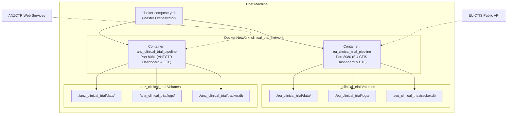

# Clinical Trial Multi-Container Platform

A unified multi-container ETL and analytics platform orchestrating global clinical trial ingestion pipelines for:
- **EU Clinical Trials (CTIS)**: European Medicines Agency Clinical Trials Information System.
- **ANZ Clinical Trials (ANZCTR)**: Australian New Zealand Clinical Trials Registry.

Both services are packaged as independent Docker containers with automated cron scheduling, local & cloud storage backends (AWS S3 & DynamoDB / SQLite), and embedded web dashboard servers, orchestrated seamlessly via **Docker Compose**.

---

## Architecture Overview



---

## Directory Structure

```text
Clinical Trial/
├── docker-compose.yml           # Master multi-container Docker Compose configuration
├── .env.example                 # Root environment variables and port mappings
├── .gitignore                   # Global Git ignore rules
├── Makefile                     # Shortcut orchestration commands (up, down, logs, status)
├── README.md                    # Platform documentation
│
├── eu_clinical_trial/           # EU CTIS Pipeline & Web Service
│   ├── ctis_etl/                # Core ETL package (API client, parser, storage, db)
│   ├── data/                    # Output data (Bronze raw JSON, Silver domain JSONs)
│   ├── docs/                    # Architectural and API specifications
│   ├── logs/                    # Pipeline and cron execution logs
│   ├── quarantine/              # Malformed records queue
│   ├── .dockerignore            # Docker build ignore rules
│   ├── .env.example             # Service-specific environment template
│   ├── crontab                  # Cron schedule definition (default: 02:00 AM UTC)
│   ├── Dockerfile               # Production container definition (Python 3.11-slim)
│   ├── entrypoint.sh            # Container bootstrapper & dashboard daemon
│   ├── requirements.txt         # Service Python dependencies
│   └── tracker.db               # SQLite state tracking database
│
└── anz_clinical_trial/          # ANZCTR Pipeline & Web Service
    ├── anz_etl/                 # Core ETL package (API client, parser, storage, db)
    ├── data/                    # Output data (Bronze raw payloads, Silver domain JSONs)
    ├── docs/                    # Documentation & API specifications
    │   └── API Document.md      # ANZCTR Web Services documentation
    ├── logs/                    # Pipeline and cron execution logs
    ├── quarantine/              # Malformed records queue
    ├── .dockerignore            # Docker build ignore rules
    ├── .env.example             # Service-specific environment template
    ├── crontab                  # Cron schedule definition (default: 03:00 AM UTC)
    ├── Dockerfile               # Production container definition (Python 3.11-slim)
    ├── entrypoint.sh            # Container bootstrapper & dashboard daemon
    ├── requirements.txt         # Service Python dependencies
    └── tracker.db               # SQLite state tracking database
```

---

## Service Endpoints & Port Allocation

| Service | Container Name | Host Port | Internal Port | Web Dashboard / API |
| :--- | :--- | :--- | :--- | :--- |
| **EU CTIS** | `eu_clinical_trial_pipeline` | `8080` | `8080` | [http://localhost:8080/](http://localhost:8080/) |
| **ANZCTR** | `anz_clinical_trial_pipeline` | `8081` | `8081` | [http://localhost:8081/](http://localhost:8081/) |

---

## Prerequisites

1. **Docker & Docker Compose**:
   - Docker Engine 20.10+ or Docker Desktop (Windows / macOS / Linux).
   - Docker Compose v2 (`docker compose`) or Compose v1 (`docker-compose`).
2. **Ports**:
   - Ensure host ports `8080` and `8081` are available (or customize them via environment variables).

---

## Configuration & Environment Variables

### Service Environment Files

Each service maintains its own `.env` configuration file in its respective directory:
- `eu_clinical_trial/.env`
- `anz_clinical_trial/.env`

If creating a fresh setup from scratch, copy the example files:

```bash
cp eu_clinical_trial/.env.example eu_clinical_trial/.env
cp anz_clinical_trial/.env.example anz_clinical_trial/.env
```

### Global Compose Overrides

You can create an optional `.env` file at the root repository level (copied from `.env.example`) to override global ports, startup triggers, or cron schedules:

| Variable | Default | Description |
| :--- | :--- | :--- |
| `EU_PORT` | `8080` | Host port mapped to the EU CTIS dashboard |
| `ANZ_PORT` | `8081` | Host port mapped to the ANZCTR dashboard |
| `EU_STARTUP_MODE` | `status` | Mode run on EU container boot (`status`, `report`, `incremental`, `historical`) |
| `ANZ_STARTUP_MODE` | `status` | Mode run on ANZ container boot (`status`, `report`, `incremental`, `historical`) |
| `EU_RUN_ON_STARTUP` | `true` | Whether EU container runs the startup task upon launch |
| `ANZ_RUN_ON_STARTUP` | `true` | Whether ANZ container runs the startup task upon launch |
| `EU_CRON_SCHEDULE` | `0 2 * * *` | Cron schedule for EU CTIS daily incremental sync |
| `ANZ_CRON_SCHEDULE` | `0 3 * * *` | Cron schedule for ANZCTR daily incremental sync |

---

## Docker & Docker Compose Instructions

### 1. Building Container Images

Build all service images defined in `docker-compose.yml`:

```bash
# Build all images
docker-compose build

# Rebuild from scratch without using cached layers
docker-compose build --no-cache

# Build a single service only
docker-compose build eu_clinical_trial
docker-compose build anz_clinical_trial
```

### 2. Starting Containers

Start services in detached (background) mode:

```bash
# Start all containers in the background
docker-compose up -d

# Start with build check
docker-compose up -d --build

# Start only one specific service
docker-compose up -d eu_clinical_trial
docker-compose up -d anz_clinical_trial
```

To run in the foreground (useful for debugging initial container startup):

```bash
docker-compose up
```

### 3. Monitoring & Status

Check the status and health of the running containers:

```bash
# List container state and mapped ports
docker-compose ps

# Monitor live CPU and memory usage
docker stats eu_clinical_trial_pipeline anz_clinical_trial_pipeline
```

### 4. Viewing & Streaming Logs

Stream live logs from containers:

```bash
# Tail logs from all services combined
docker-compose logs -f

# Tail logs with timestamps
docker-compose logs -f -t

# Tail last 100 lines for EU CTIS pipeline
docker-compose logs --tail=100 -f eu_clinical_trial

# Tail last 100 lines for ANZCTR pipeline
docker-compose logs --tail=100 -f anz_clinical_trial
```

### 5. Running Manual Pipeline Commands Inside Containers

Execute commands inside active containers without restarting them:

#### EU CTIS Service Commands
```bash
# Check pipeline health and connectivity
docker-compose exec eu_clinical_trial python -m ctis_etl.main --mode check

# Display current pipeline sync statistics
docker-compose exec eu_clinical_trial python -m ctis_etl.main --mode status

# Generate dashboard status report
docker-compose exec eu_clinical_trial python -m ctis_etl.main --mode report

# Run incremental sync (lookback 7 days)
docker-compose exec eu_clinical_trial python -m ctis_etl.main --mode incremental --lookback-days 7

# Run full historical backfill with 5 workers
docker-compose exec eu_clinical_trial python -m ctis_etl.main --mode historical --workers 5

# Fetch a single trial by EU CT number
docker-compose exec eu_clinical_trial python -m ctis_etl.main --mode single --ct-number 2023-504423-38-00
```

#### ANZCTR Service Commands
```bash
# Query initial 5 endpoints (Search, result, detail, detailv2, detailresult) & collect only raw XML data
docker-compose exec anz_clinical_trial python -m anz_etl.main --mode raw --actrn ACTRN12613000001741

# Run standalone raw API test script
docker-compose exec anz_clinical_trial python test_raw_apis.py ACTRN12613000001741 oncology

# Check pipeline health and web service connectivity
docker-compose exec anz_clinical_trial python -m anz_etl.main --mode check

# Display current pipeline sync statistics
docker-compose exec anz_clinical_trial python -m anz_etl.main --mode status

# Generate HTML dashboard
docker-compose exec anz_clinical_trial python -m anz_etl.main --mode report

# Run incremental sync
docker-compose exec anz_clinical_trial python -m anz_etl.main --mode incremental --lookback-days 7

# Fetch a single trial by ACTRN
docker-compose exec anz_clinical_trial python -m anz_etl.main --mode single --actrn ACTRN12613000001741

# Retry failed trials
docker-compose exec anz_clinical_trial python -m anz_etl.main --mode retry-failed
```

### 6. Interactive Shell Access

Attach an interactive Bash shell to any running container:

```bash
# Interactive shell in EU container
docker-compose exec eu_clinical_trial /bin/bash

# Interactive shell in ANZ container
docker-compose exec anz_clinical_trial /bin/bash
```

Inside the container shell, you can inspect paths, environment variables, cron tasks, and logs:
```bash
# Check active environment
env

# Check cron tasks
crontab -l

# View log files
cat /app/logs/cron.log
tail -n 50 /app/logs/webserver.log
```

### 7. Stopping and Restarting Containers

```bash
# Restart both containers
docker-compose restart

# Restart a specific service
docker-compose restart eu_clinical_trial
docker-compose restart anz_clinical_trial

# Gracefully stop containers (preserves container state)
docker-compose stop

# Resume stopped containers
docker-compose start
```

### 8. Teardown & Resetting State

```bash
# Stop and remove containers and internal network
docker-compose down

# Stop, remove containers, and clean up orphan containers
docker-compose down --remove-orphans

# Complete reset (removes containers, networks, and named volumes)
docker-compose down -v
```

---

## Makefile Command Reference

If you have `make` installed on your host, you can use these convenient shortcuts:

| Command | Equivalent Docker Compose Command | Description |
| :--- | :--- | :--- |
| `make build` | `docker-compose build` | Build all container images |
| `make up` | `docker-compose up -d` | Launch all containers in detached mode |
| `make down` | `docker-compose down` | Stop and remove all containers and network |
| `make restart` | `docker-compose restart` | Restart all services |
| `make ps` | `docker-compose ps` | Show container statuses and port mappings |
| `make logs` | `docker-compose logs -f` | Tail logs from all containers |
| `make logs-eu` | `docker-compose logs -f eu_clinical_trial` | Tail logs from EU CTIS container |
| `make logs-anz` | `docker-compose logs -f anz_clinical_trial` | Tail logs from ANZCTR container |
| `make status` | `docker-compose exec ... status` | Print status reports from both services |

---

## Persistent Storage & Volumes

All trial payloads, databases, and logs are persisted to the host machine through bind mounts:

- **EU CTIS Volumes**:
  - `./eu_clinical_trial/data` $\rightarrow$ `/app/data` (Bronze `raw.json` & Silver domain JSONs)
  - `./eu_clinical_trial/logs` $\rightarrow$ `/app/logs` (application, cron, and dashboard logs)
  - `./eu_clinical_trial/quarantine` $\rightarrow$ `/app/quarantine` (malformed payloads)
  - `./eu_clinical_trial/tracker.db` $\rightarrow$ `/app/tracker.db` (SQLite state database)
- **ANZCTR Volumes**:
  - `./anz_clinical_trial/data` $\rightarrow$ `/app/data` (Bronze `raw.xml` & Silver domain JSONs)
  - `./anz_clinical_trial/logs` $\rightarrow$ `/app/logs` (application, cron, and dashboard logs)
  - `./anz_clinical_trial/quarantine` $\rightarrow$ `/app/quarantine` (malformed payloads)
  - `./anz_clinical_trial/tracker.db` $\rightarrow$ `/app/tracker.db` (SQLite state database)

Data remains safely preserved on the host even when containers are stopped, removed, or rebuilt.

---

## Troubleshooting & Common Questions

### Port Conflicts
- **Symptom**: `Bind for 0.0.0.0:8080 failed: port is already allocated`.
- **Solution**: Set custom ports in your root `.env` or prefix your run command:
  ```bash
  EU_PORT=8090 ANZ_PORT=8091 docker-compose up -d
  ```

### Docker Daemon Not Running
- **Symptom**: `failed to connect to the docker API at npipe:////./pipe/docker_engine`.
- **Solution**: Start Docker Desktop on Windows/macOS, or start the Docker daemon on Linux with `sudo systemctl start docker`.

### Shell Script Line Endings (CRLF vs LF)
- **Symptom**: `/app/entrypoint.sh: line 2: $'\r': command not found`.
- **Solution**: Ensure `entrypoint.sh` and `crontab` files maintain Unix LF line endings:
  ```bash
  python -c "for p in ['eu_clinical_trial/entrypoint.sh', 'anz_clinical_trial/entrypoint.sh']: open(p, 'wb').write(open(p, 'rb').read().replace(b'\r\n', b'\n'))"
  ```

### SQLite tracker.db Bind Mount Quirk
- **Symptom**: `tracker.db` is created as a directory on the host rather than a file.
- **Solution**: Docker automatically creates directories for bind-mounted files if they do not exist before container startup. Both pipelines include safety guards in their configuration to detect directory mounts and locate `tracker.db/tracker.db` automatically, but pre-creating an empty file (`touch tracker.db`) ensures standard single-file mounting.
