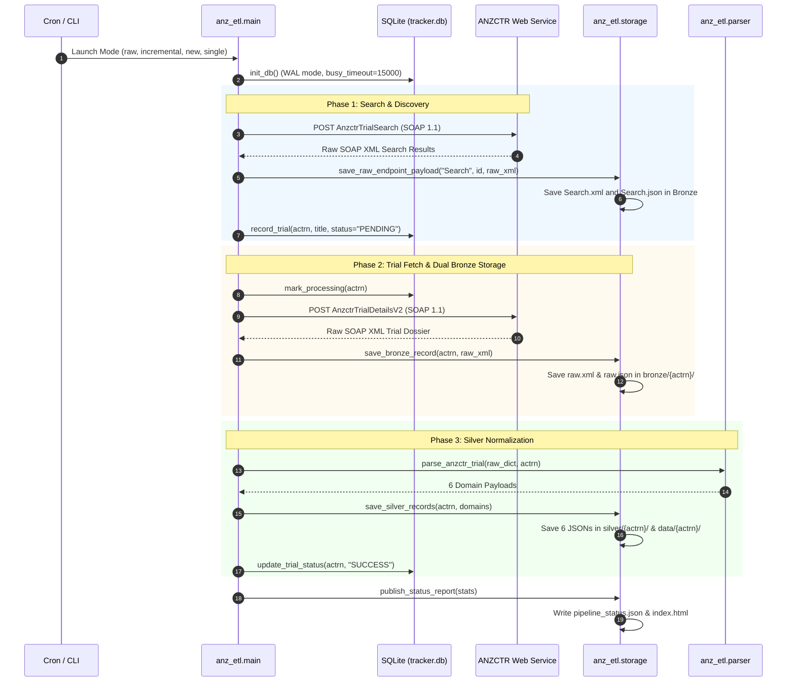
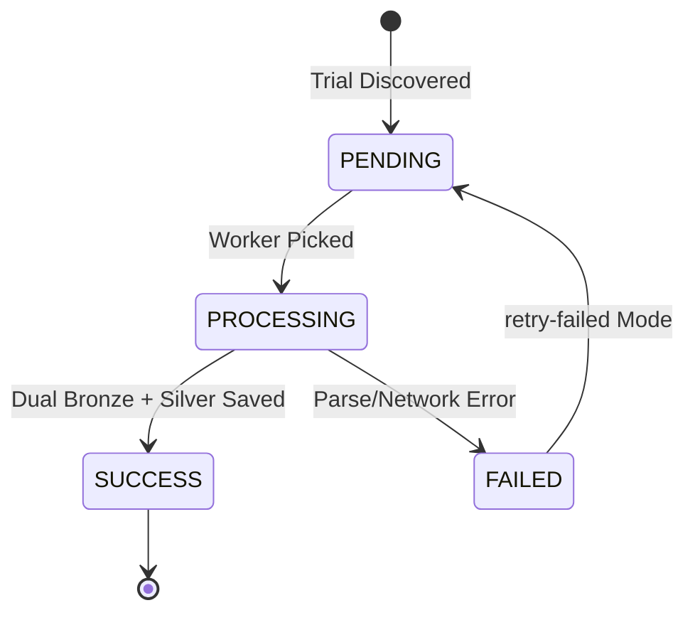

# ANZCTR Clinical Trial Data Pipeline (ETL)

[](https://www.python.org/downloads/)
[](#data-normalization-architecture-bronze--silver-tiers)
[](#state-management--database-design)
[](#docker-deployment--automated-scheduling)
[](#web-dashboard--live-monitoring)

A production-grade, fault-tolerant Python ETL (Extract, Transform, Load) pipeline engineered to ingest, normalize, and synchronize clinical trial data from the **Australian New Zealand Clinical Trials Registry (ANZCTR)** public SOAP/ASMX Web Services.

The pipeline ingests raw trial dossiers into a dual **Bronze Layer** (storing both the untouched raw XML and converted companion JSON side-by-side) and normalizes them into a structured **Silver Layer** (6 standardized domain JSON payloads). It supports dual state tracking across **Local SQLite (WAL Mode)** and **Amazon DynamoDB**, automated background cron scheduling, and an embedded web monitoring dashboard on port `8081`.

---

## Table of Contents

- [1. Executive Summary & Regulatory Context](#1-executive-summary--regulatory-context)
- [2. System Architecture & Topology](#2-system-architecture--topology)
- [3. End-to-End Pipeline Execution Flow](#3-end-to-end-pipeline-execution-flow)
- [4. ANZCTR Web Services API Specification](#4-anzctr-web-services-api-specification)
  - [4.1 Service Endpoint & Protocol](#41-service-endpoint--protocol)
  - [4.2 The 5 Initial API Operations](#42-the-5-initial-api-operations)
  - [4.3 SOAP Request Envelopes & Headers](#43-soap-request-envelopes--headers)
  - [4.4 XML to JSON Companion Conversion](#44-xml-to-json-companion-conversion)
- [5. Data Normalization Architecture (Bronze & Silver Tiers)](#5-data-normalization-architecture-bronze--silver-tiers)
  - [5.1 Bronze Tier (Dual Raw XML & JSON)](#51-bronze-tier-dual-raw-xml--json)
  - [5.2 Silver Tier (6 Standard Domain Entities)](#52-silver-tier-6-standard-domain-entities)
  - [5.3 Quarantine Tier (Dead-Letter Handling)](#53-quarantine-tier-dead-letter-handling)
- [6. State Management & Database Design](#6-state-management--database-design)
  - [6.1 SQLite Engine with WAL Mode](#61-sqlite-engine-with-wal-mode)
  - [6.2 AWS DynamoDB Engine](#62-aws-dynamodb-engine)
  - [6.3 Lifecycle State Machine](#63-lifecycle-state-machine)
- [7. CLI Operational Modes & Usage](#7-cli-operational-modes--usage)
  - [7.1 Operational Modes Reference](#71-operational-modes-reference)
  - [7.2 Command Examples](#72-command-examples)
- [8. Docker Deployment & Automated Scheduling](#8-docker-deployment--automated-scheduling)
  - [8.1 Container Architecture](#81-container-architecture)
  - [8.2 Automated Cron Scheduling](#82-automated-cron-scheduling)
  - [8.3 Web Dashboard & Live Monitoring](#83-web-dashboard--live-monitoring)
- [9. Configuration & Environment Variables](#9-configuration--environment-variables)
- [10. Standalone Testing Utility (`test_raw_apis.py`)](#10-standalone-testing-utility-test_raw_apispy)
- [11. Troubleshooting & Operations FAQ](#11-troubleshooting--operations-faq)

---

## 1. Executive Summary & Regulatory Context

The **Australian New Zealand Clinical Trials Registry (ANZCTR)** is an online register of clinical trials being undertaken in Australia, New Zealand, and globally. Established at the NHMRC Clinical Trials Centre (University of Sydney), ANZCTR is recognized as an official Primary Registry in the World Health Organization (WHO) International Clinical Trials Registry Platform (ICTRP) and meets the standards of the International Committee of Medical Journal Editors (ICMJE).

### What This Pipeline Delivers

1. **Dual Bronze Ingestion**: Ingests the authentic raw XML response from ANZCTR and simultaneously saves a converted, structured JSON companion for rapid downstream analytics.
2. **5 Core Operations Targeted**: Integrates with `AnzctrTrialSearch`, `ActSearchResults`, `AnzctrTrialDetails`, `AnzctrTrialDetailsV2`, and `ActMoreInfo`.
3. **Domain Normalization (Silver Layer)**: Maps raw trial structures into 6 distinct domain JSON payloads matching enterprise schemas.
4. **Autonomous Synchronization**: Cron-driven jobs discover new trials every 6 hours and update existing records daily at 03:00 AM UTC.
5. **Zero-Lock State Tracking**: Uses SQLite in Write-Ahead Logging (WAL) mode for local concurrency and Amazon DynamoDB for cloud tracking.
6. **Live Dashboard & Status Reporting**: Exposes an auto-refreshing web dashboard and `pipeline_status.json` on port `8081`.

---

## 2. System Architecture & Topology

```text
                              ┌──────────────────────────────────────────────┐
                              │          ANZCTR ASMX Web Services            │
                              │ https://api.anzctr.org.au/WebServices/       │
                              │         AnzctrWebservices.asmx               │
                              │  - AnzctrTrialSearch                         │
                              │  - ActSearchResults                          │
                              │  - AnzctrTrialDetails                        │
                              │  - AnzctrTrialDetailsV2                      │
                              │  - ActMoreInfo                               │
                              └──────────────────────┬───────────────────────┘
                                                     │ HTTPS SOAP 1.1 / XML
                                                     │ SOAPAction Header
                                                     ▼
                              ┌──────────────────────────────────────────────┐
                              │              AnzctrClient Layer              │
                              │  - SOAP 1.1 Envelope Builder                 │
                              │  - Requests Session with Retries & Backoff   │
                              │  - Raw XML Capture                           │
                              │  - Python xml.etree / xmltodict Converter    │
                              └──────────────────────┬───────────────────────┘
                                                     │
                              ┌──────────────────────┴───────────────────────┐
                              ▼                                              ▼
                ┌───────────────────────────┐                  ┌───────────────────────────┐
                │     State & Tracker       │                  │    Extraction & Storage   │
                │      (database.py)        │                  │       (storage.py)        │
                │  - SQLite (WAL Mode)      │                  │  - Dual Bronze (XML+JSON) │
                │  - Amazon DynamoDB        │                  │  - Silver 6 Domain Split  │
                │  - PENDING / SUCCESS /    │                  │  - Quarantine Error Queue │
                │    FAILED Lifecycle       │                  │  - S3 Cloud Sync (opt)    │
                └─────────────┬─────────────┘                  └─────────────┬─────────────┘
                              │                                              │
                ┌─────────────┴─────────────┐                  ┌─────────────┴─────────────┐
                ▼                           ▼                  ▼                           ▼
    ┌───────────────────────┐   ┌───────────────────────┐  ┌───────────────────────┐   ┌───────────────────────┐
    │  SQLite (tracker.db)  │   │   AWS DynamoDB Table  │  │ Local Disk (./data/)  │   │    Amazon S3 Bucket   │
    │  - anz_trials table   │   │   Table: ANZ_Clinical │  │ - bronze/{actrn}/     │   │ - anzctr/bronze/...   │
    │  - WAL journal mode   │   │   PK: anzctr#{actrn}  │  │ - silver/{actrn}/     │   │ - anzctr/silver/...   │
    │  - busy_timeout=15s   │   │   Cloud state synced  │  │ - raw/{operation}/    │   │ - anzctr/raw/...      │
    └───────────────────────┘   └───────────────────────┘  └───────────────────────┘   └───────────────────────┘
```

---

## 3. End-to-End Pipeline Execution Flow



---

## 4. ANZCTR Web Services API Specification

### 4.1 Service Endpoint & Protocol

- **Endpoint URL**: `https://api.anzctr.org.au/WebServices/AnzctrWebservices.asmx`
- **WSDL Definition**: `https://api.anzctr.org.au/WebServices/AnzctrWebservices.asmx?WSDL`
- **Protocol**: SOAP 1.1 / 1.2 over HTTPS
- **Target Namespace**: `http://anzctr.org.au/WebServices/AnzctrWebServices`

### 4.2 The 5 Initial API Operations

| # | Operation | ASMX Method | SOAPAction Header | Purpose |
| :---: | :--- | :--- | :--- | :--- |
| **1** | **`Search`** | `AnzctrTrialSearch` | `"http://anzctr.org.au/WebServices/AnzctrWebServices/AnzctrTrialSearch"` | Comprehensive search query across trials |
| **2** | **`result`** | `ActSearchResults` | `"http://anzctr.org.au/WebServices/AnzctrWebServices/ActSearchResults"` | Specialized query returning trial search result sets |
| **3** | **`detail`** | `AnzctrTrialDetails` | `"http://anzctr.org.au/WebServices/AnzctrWebServices/AnzctrTrialDetails"` | Retrieves detailed trial record by ID |
| **4** | **`detailv2`** | `AnzctrTrialDetailsV2` | `"http://anzctr.org.au/WebServices/AnzctrWebServices/AnzctrTrialDetailsV2"` | Comprehensive Schema V2 trial dossier by ID |
| **5** | **`detailresult`** | `ActMoreInfo` | `"http://anzctr.org.au/WebServices/AnzctrWebServices/ActMoreInfo"` | Supplementary trial outcomes and result records |

### 4.3 SOAP Request Envelopes & Headers

Every request is sent as an HTTP `POST` with:
```http
POST /WebServices/AnzctrWebservices.asmx HTTP/1.1
Host: api.anzctr.org.au
Content-Type: text/xml; charset=utf-8
SOAPAction: "http://anzctr.org.au/WebServices/AnzctrWebServices/AnzctrTrialDetailsV2"
```

Sample XML payload for `AnzctrTrialDetailsV2`:
```xml
<?xml version="1.0" encoding="utf-8"?>
<soap:Envelope xmlns:xsi="http://www.w3.org/2001/XMLSchema-instance" 
               xmlns:xsd="http://www.w3.org/2001/XMLSchema" 
               xmlns:soap="http://schemas.xmlsoap.org/soap/envelope/">
  <soap:Body>
    <AnzctrTrialDetailsV2 xmlns="http://anzctr.org.au/WebServices/AnzctrWebServices">
      <ids>ACTRN12613000001741</ids>
      <version>1</version>
    </AnzctrTrialDetailsV2>
  </soap:Body>
</soap:Envelope>
```

### 4.4 XML to JSON Companion Conversion

Because the ANZCTR server communicates natively in XML, [`anz_etl/storage.py`](file:///d:/Workspace/Projects/Clinical%20Trial/anz_clinical_trial/anz_etl/storage.py) runs an automated parser (`xmltodict` with a fallback to `xml.etree.ElementTree`) on every raw response. 

Every XML payload automatically receives a side-by-side JSON companion file containing the exact parsed object hierarchy.

---

## 5. Data Normalization Architecture (Bronze & Silver Tiers)

```text
data/
├── bronze/                                 # Bronze Layer (Raw Audit Tier)
│   └── ACTRN12613000001741/
│       ├── raw.xml                         # Exact raw SOAP XML response
│       ├── raw.json                        # Parsed JSON companion
│       ├── Search.xml & Search.json        # Operation 1 capture
│       ├── result.xml & result.json        # Operation 2 capture
│       ├── detail.xml & detail.json        # Operation 3 capture
│       ├── detailv2.xml & detailv2.json    # Operation 4 capture
│       └── detailresult.xml & .json        # Operation 5 capture
│
├── silver/                                 # Silver Layer (6 Normalized Domain Entities)
│   └── ACTRN12613000001741/
│       ├── meta_data.json
│       ├── summary.json
│       ├── full_trial_information.json
│       ├── trial_documents.json
│       ├── trial_results.json
│       └── locations_and_contact_points.json
│
├── quarantine/                             # Dead-letter queue for failed/unparseable records
│   └── ACTRN12613000001741_20261105.json
│
├── pipeline_status.json                    # Real-time metrics JSON
└── index.html                              # Web monitoring dashboard
```

### 5.1 Bronze Tier (Dual Raw XML & JSON)

- **Purpose**: Immutable source of truth preserving exact registry messages.
- **Dual Representation**: Stores `.xml` (for regulatory replay) and `.json` (for immediate analytics).
- **Zero Transformation**: No fields are stripped or renamed in this tier.

### 5.2 Silver Tier (6 Standard Domain Entities)

Derived from the raw trial dossier and normalized by [`anz_etl/parser.py`](file:///d:/Workspace/Projects/Clinical%20Trial/anz_clinical_trial/anz_etl/parser.py):

1. **`meta_data.json`**: ACTRN, registry identifier, public title, scientific title, registration dates, recruitment status.
2. **`summary.json`**: Brief summary, primary sponsor, health conditions, interventions, target sample size.
3. **`full_trial_information.json`**: Study type, phase, design, inclusion/exclusion criteria, primary & secondary outcomes.
4. **`trial_documents.json`**: Protocol references, registry review URL, attachments.
5. **`trial_results.json`**: Result summary, outcome indicators, publications.
6. **`locations_and_contact_points.json`**: Study sites, trial countries, principal investigators, public contacts.

### 5.3 Quarantine Tier (Dead-Letter Handling)

Any payload that fails validation or schema extraction is routed to `./quarantine/{actrn}_{timestamp}.json` alongside the complete error trace, preventing pipeline stalls.

---

## 6. State Management & Database Design

### 6.1 SQLite Engine with WAL Mode

The pipeline tracks state locally in [`tracker.db`](file:///d:/Workspace/Projects/Clinical%20Trial/anz_clinical_trial/tracker.db). On initialization, the connection executes:

```sql
PRAGMA journal_mode=WAL;
PRAGMA busy_timeout=15000;
```

This enables **Write-Ahead Logging**, permitting concurrent reads from the web dashboard while background workers write trial state without table locks.

#### Schema (`anz_trials` Table)

```sql
CREATE TABLE IF NOT EXISTS anz_trials (
    actrn TEXT PRIMARY KEY,
    title TEXT,
    registration_date TEXT,
    last_updated_date TEXT,
    sync_status TEXT NOT NULL DEFAULT 'PENDING',
    attempts INTEGER DEFAULT 0,
    last_checked TEXT,
    error_message TEXT,
    created_at TEXT NOT NULL,
    updated_at TEXT NOT NULL
);
CREATE INDEX IF NOT EXISTS idx_anz_sync_status ON anz_trials(sync_status);
CREATE INDEX IF NOT EXISTS idx_anz_updated_date ON anz_trials(last_updated_date);
```

### 6.2 AWS DynamoDB Engine

When configured (`STATE_BACKEND=dynamodb` or `both`), state is synchronized to DynamoDB:

- **Table Name**: `ANZ_Clinical`
- **Partition Key (`pk`)**: `anzctr#{actrn}`
- **Attributes**: `sync_status`, `attempts`, `last_checked`, `error_message`, `updated_at`.

### 6.3 Lifecycle State Machine



---

## 7. CLI Operational Modes & Usage

### 7.1 Operational Modes Reference

| Mode | Command Flag | Description |
| :--- | :--- | :--- |
| **`check`** | `--mode check` | Validates API endpoint health, directory structures, and database connection |
| **`status`** | `--mode status` | Prints real-time tracking metrics (total, success, failed, pending) |
| **`report`** | `--mode report` | Writes `pipeline_status.json` and updates `data/index.html` dashboard |
| **`raw`** | `--mode raw` | Queries all 5 initial APIs and saves `.xml` + `.json` side-by-side in Bronze |
| **`single`** | `--mode single --actrn <ID>` | Fetches and processes a single trial through the complete ETL lifecycle |
| **`incremental`** | `--mode incremental` | Discovers and syncs trials modified or registered in the last $N$ days |
| **`historical`** | `--mode historical` | Full catalog ingestion using parallel worker threads |
| **`new`** | `--mode new` | Discovers and ingests only newly registered trials |
| **`updates`** | `--mode updates` | Checks and updates existing trials |
| **`retry-failed`** | `--mode retry-failed` | Retries failed items from the SQLite tracker queue |

### 7.2 Command Examples

```bash
# Pre-flight health check
python -m anz_etl.main --mode check

# Print current pipeline status
python -m anz_etl.main --mode status

# Collect raw XML + JSON from all 5 initial endpoints
python -m anz_etl.main --mode raw --actrn ACTRN12613000001741

# Ingest single trial end-to-end
python -m anz_etl.main --mode single --actrn ACTRN12613000001741

# Run daily incremental sync (lookback 7 days, 5 worker threads)
python -m anz_etl.main --mode incremental --lookback-days 7 --workers 5

# Retry all failed trials
python -m anz_etl.main --mode retry-failed
```

---

## 8. Docker Deployment & Automated Scheduling

### 8.1 Container Architecture

The container is packaged using **`python:3.11-slim`** and includes:

- **Cron Daemon**: Schedules background discovery and sync tasks.
- **Python HTTP Server**: Exposes the live web dashboard on port `8081`.
- **Log Streamer**: Tails pipeline and cron logs to Docker `stdout` for centralized observability.

### 8.2 Automated Cron Scheduling

The bundled crontab runs:
```cron
# Process 1: Check for new trials every 6 hours
0 */6 * * * root /bin/bash -c ". /app/env.sh && python -m anz_etl.main --mode new >> /app/logs/cron.log 2>&1"

# Process 2: Check for updates daily at 03:00 AM UTC
0 3 * * * root /bin/bash -c ". /app/env.sh && python -m anz_etl.main --mode updates >> /app/logs/cron.log 2>&1"

# Process 3: Refresh web dashboard daily at 04:00 AM UTC
0 4 * * * root /bin/bash -c ". /app/env.sh && python -m anz_etl.main --mode report >> /app/logs/cron.log 2>&1"
```

### 8.3 Web Dashboard & Live Monitoring

When the container runs, browse to:
```text
http://localhost:8081/
```
The dashboard displays total tracked trials, success rates, failed items, and direct links to browse raw Bronze XML/JSON and Silver payloads.

---

## 9. Configuration & Environment Variables

Settings are read from `.env` in the `anz_clinical_trial/` directory:

| Variable | Default | Description |
| :--- | :--- | :--- |
| `ANZCTR_WS_URL` | `https://api.anzctr.org.au/WebServices/AnzctrWebservices.asmx` | Upstream ASMX SOAP endpoint |
| `STORAGE_BACKEND` | `local` | Storage tier: `local`, `s3`, or `both` |
| `STATE_BACKEND` | `sqlite` | State tracking tier: `sqlite`, `dynamodb`, or `both` |
| `LOCAL_DATA_DIR` | `./data` | Local data root directory |
| `SQLITE_DB_PATH` | `./tracker.db` | SQLite tracking database path |
| `PORT` | `8081` | Web dashboard HTTP server port |
| `MAX_WORKERS` | `5` | Maximum parallel worker threads |
| `LOOKBACK_DAYS` | `7` | Lookback window for incremental sync |
| `CRON_SCHEDULE` | `0 3 * * *` | Cron schedule string |
| `LOG_LEVEL` | `INFO` | Logging level (`DEBUG`, `INFO`, `WARNING`) |
| `AWS_ACCESS_KEY_ID` | `""` | AWS credential (if S3/DynamoDB enabled) |
| `AWS_SECRET_ACCESS_KEY` | `""` | AWS secret key |
| `AWS_REGION` | `ap-southeast-2` | AWS region |
| `S3_BUCKET_NAME` | `""` | Destination S3 bucket |
| `S3_PREFIX` | `anzctr/` | S3 key prefix |
| `DYNAMODB_TABLE_NAME` | `ANZ_Clinical` | DynamoDB table name |

---

## 10. Standalone Testing Utility (`test_raw_apis.py`)

For rapid testing outside the main CLI:

```bash
cd anz_clinical_trial
python test_raw_apis.py ACTRN12613000001741 "oncology"
```

This sequentially executes all 5 initial endpoints and prints the byte size and output filename for each response.

---

## 11. Troubleshooting & Operations FAQ

### Upstream SOAP Fault: `User Unauthorised`

- **Cause**: The ANZCTR ASMX service requires authenticated credentials, a developer token, or an authorized IP header to query live trials.
- **Resolution**: Provide credentials or user headers in `.env` to be injected into the SOAP envelope headers.

### Port 8081 In Use

- **Resolution**: Change `PORT=8082` in `anz_clinical_trial/.env` and update the port mapping in `docker-compose.yml`.

### SQLite `tracker.db` Mounted as a Directory in Docker

- **Resolution**: Both `config.py` and `database.py` contain automatic directory resolvers (`if path.is_dir(): path = path / "tracker.db"`), but pre-creating an empty file ensures clean bind mounting.
